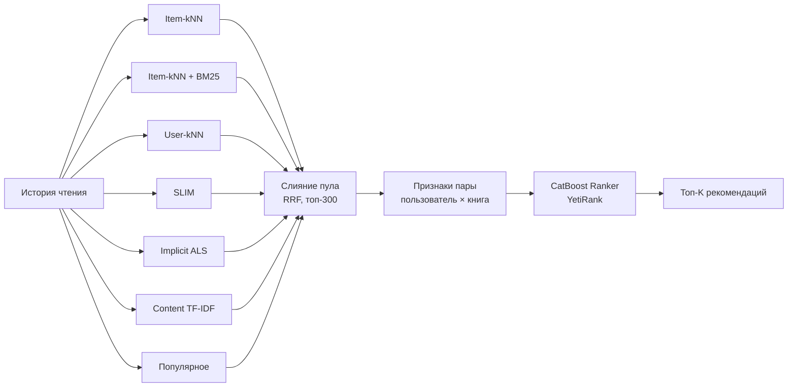

# Рекомендательная система для книг

Двухуровневая рекомендательная система для онлайн-библиотеки: первый уровень отбирает кандидатов с помощью шести моделей (коллаборативная фильтрация, матричная факторизация, контентная модель), второй уровень переранжирует их градиентным бустингом CatBoost с функцией потерь YetiRank.

Проект построен как воспроизводимый пайплайн без утечек данных: разбиение производится по времени, каталог и статистики считаются только по прошлому, а тестовая выборка используется один раз, для итоговой оценки.

## Задача и данные

Нужно предсказать, какие книги пользователь прочитает в будущем, по его истории чтения.

Данные — открытый датасет онлайн-библиотеки:

- `interactions.csv` — 1.53 млн взаимодействий: `user_id`, `item_id`, `progress` (процент прочитанного), `rating` (оценка 1–5, есть не всегда), `start_date`;
- `items.csv` — метаданные книг: `title`, `genres`, `authors`, `year`.

Явных отрицательных отзывов почти нет, поэтому задача сформулирована как работа с неявным фидбеком: положительным считается взаимодействие с оценкой ≥ 4 или прогрессом чтения ≥ 80%. Книги с оценкой ниже 1.5 исключаются, даже если дочитаны.

## Ключевые результаты

Итоговая оценка на отложенном по времени тестовом периоде (1034 пользователя, все методы ранжируют один и тот же пул кандидатов):

| Метод | NDCG@10 | Recall@10 | HitRate@10 | Recall@20 |
|---|---:|---:|---:|---:|
| **Двухуровневая модель (CatBoost YetiRank)** | **0.0809** | **0.1196** | 0.2331 | **0.1930** |
| Слияние кандидатов (RRF) | 0.0751 | 0.1112 | 0.2234 | 0.1842 |
| Item-kNN | 0.0795 | 0.1083 | 0.2176 | 0.1619 |
| Implicit ALS | 0.0756 | 0.1141 | 0.2282 | 0.1877 |
| SLIM | 0.0762 | 0.1122 | **0.2456** | 0.1708 |
| Content-based (TF-IDF) | 0.0503 | 0.0747 | 0.1518 | 0.1306 |
| Популярное | 0.0099 | 0.0119 | 0.0464 | 0.0199 |

- Ранкер второго уровня улучшает NDCG@10 на **7.7%** относительно слияния кандидатов (RRF) и в **8 раз** относительно бейзлайна по популярности.
- Каждый четвёртый пользователь получает в топ-10 книгу, которую он действительно прочитал в следующем периоде.
- Объединённый пул кандидатов покрывает **83%** будущих прочтений (против 61% у лучшей одиночной модели), то есть второй уровень работает с гораздо более полным набором.

## Архитектура



### 1. Подготовка данных

Порядок шагов выбран так, чтобы информация из будущего не попадала в обучение:

1. Дедупликация пар (пользователь, книга): берётся максимальный прогресс, средняя оценка и самая ранняя дата.
2. Отбор положительных взаимодействий.
3. Фильтр пользователей с историей не меньше 10 книг.
4. **Разбиение по глобальной дате** на train / val / test (80 / 10 / 10%) — как в продакшене: модель знает всё до «сегодня» и предсказывает будущее.
5. **k-core фильтр только на train** (книга ≥ 20 читателей, пользователь ≥ 3 книг): пороги популярности, посчитанные на всём периоде, использовали бы будущее.
6. Единый каталог пользователей и книг строится по train, все модели работают в его индексах.
7. Из val/test удаляются уже прочитанные пары и объекты вне каталога.

Поддерживается и альтернативная схема разбиения — по времени внутри истории каждого пользователя (`--scheme per_user`).

### 2. Первый уровень: генераторы кандидатов

Основная цель генераторов - составить пул кандидатов с высоким **Recall**. Каждый генератор реализует общий интерфейс `CandidateGenerator` (`fit` → `score` → `recommend`) и отдаёт по 200 кандидатов на пользователя, исключая уже прочитанное.

| Модель | Идея | Recall@200 (val) |
|---|---|---:|
| Item-kNN + BM25 | косинусное сходство книг, BM25 снижает вес «всеядных» читателей и хитов | 0.642 |
| Item-kNN | косинусное сходство книг с shrinkage | 0.635 |
| Implicit ALS | матричная факторизация с весами уверенности (прогресс + оценка) | 0.581 |
| User-kNN | книги k самых похожих пользователей | 0.569 |
| SLIM | разреженная линейная модель книга × книга, ElasticNet с ограничением весов ≥ 0 | 0.549 |
| Content-based | TF-IDF по названию, жанрам, авторам и десятилетию издания | 0.542 |
| Популярное | глобальная популярность, бейзлайн и подстраховка для коротких историй | 0.167 |

Модели, для которых важен сам факт чтения (kNN, SLIM), обучаются на бинарной матрице; ALS и контентная модель используют силу сигнала: `progress / 100 + бонус за оценку`.

Кандидаты объединяются через **Reciprocal Rank Fusion** — способ, не зависящий от масштаба оценок разных моделей. Для каждой пары сохраняются оценка и позиция от каждого генератора, число источников и итоговый балл RRF.

| Размер пула на пользователя | 100 | 200 | 300 | 500 | весь (~600) |
|---|---:|---:|---:|---:|---:|
| Recall пула (val) | 0.460 | 0.625 | **0.705** | 0.797 | 0.829 |

Рабочий размер — 300 кандидатов: компромисс между полнотой и временем обучения ранкера.

### 3. Второй уровень: ранкер

Для каждой пары (пользователь, книга) из пула строится около 30 признаков, все считаются только по истории до начала целевого периода:

- **от генераторов** — оценка и позиция в выдаче каждой модели, число моделей, предложивших книгу, балл и позиция RRF;
- **книга** — популярность и её перцентиль, доля читателей за последние 90 дней (тренд), средняя оценка и число оценок, год издания, число жанров;
- **пользователь** — размер истории, «мейнстримность» (средняя популярность прочитанного);
- **пара** — близость жанров книги к жанровому профилю пользователя, сколько книг этого автора он уже читал, отличие книги от «средней» книги пользователя по популярности и году.

Модель — `CatBoostRanker` с функцией потерь **YetiRank** и метрикой NDCG@10: она оптимизирует порядок книг внутри пользователя, а не независимую вероятность для каждой строки. Для ускорения в обучении остаются все позитивы и не более 200 случайных негативов на пользователя. Число деревьев подбирается ранней остановкой по NDCG@10 на отложенных 20% пользователей. В качестве альтернативного бэкенда доступен `HistGradientBoostingClassifier` из scikit-learn.

### 4. Схема валидации

```
          train                 val            test
|-------------------------|-------------|-------------|
 история окна val ──────────▶ цель val                     → обучение ранкера
 история окна test ─────────────────────────▶ цель test    → итоговая оценка
```

Для каждого окна первый уровень обучается заново, поэтому ни одна модель не видит период, который предсказывает. Кандидаты и признаки строятся одним и тем же кодом для обучения и оценки — это исключает рассинхрон между ними. На тесте все способы ранжирования (ранкер, RRF, каждый генератор и идеальный «оракул») сравниваются на одном пуле, одних пользователях и одной цели.

## Что можно улучшить

- Подбор гиперпараметров генераторов и ранкера на val (сейчас используются разумные стартовые значения).
- Холодный старт: сейчас пользователи без истории в train пропускаются при оценке.
- Признаки последовательности чтения (последние книги, серии, время с последнего прочтения).
- Обслуживание модели через API и периодическое переобучение.